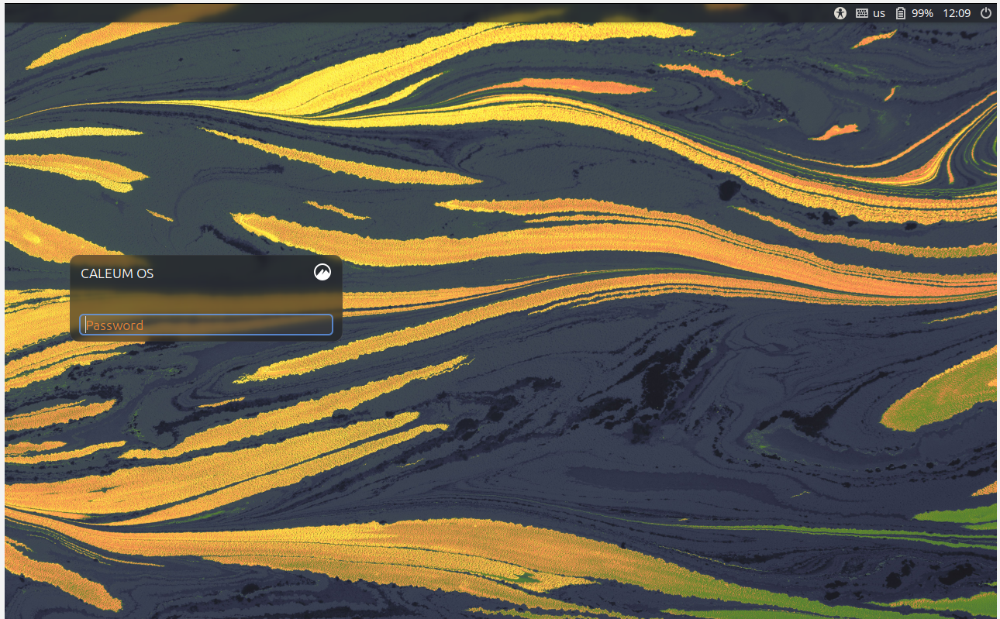

# remastering-linux-caleumOS

## CaelumOS ISO

The 7.46 GB ISO is stored as four Git LFS parts because GitHub limits each LFS file to 2 GB on Free/Pro plans.

After cloning the repository with Git LFS installed, rebuild the ISO in Windows Command Prompt from this folder:

```cmd
copy /b CaelumOS.iso.part-00+CaelumOS.iso.part-01+CaelumOS.iso.part-02+CaelumOS.iso.part-03 CaelumOS.iso
```

## Screenshots

### CaelumOS logo


### Login screen

